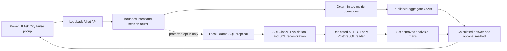

# Ask City Pulse Phase 2 — local implementation and validation

This record separates what was actually tested on 11 October 2026 from what
still needs a Power BI Desktop or protected PostgreSQL check. It is not a
claim that an autonomous agent or arbitrary SQL interface was built.

## Implemented flow



Normal one-click operation remains code-free and CSV-backed. It uses the
existing published aggregates and never changes report filters or charts.
The optional model-proposed SQL path is disabled by default and requires
protected mode, PostgreSQL, a separately provisioned reader, and a local
model. The model proposes SQL but cannot execute it or supply numeric facts.
The compiler only accepts a narrow SELECT grammar and builds a fresh query
with approved identifiers and bound values. Question/SQL scope checks also
reject a model proposal that invents an unrequested filter or changes the
requested metric. Actual execution uses a read-only transaction, timeouts,
and a bounded result.

## Data and calculation rules

`chatbot/metrics.py` defines trip count, TLC total amount (Gold
`total_revenue` from source `total_amount`), recorded tips, estimated fare
total, trip-weighted average fare, and average distance. These are distinct
measures. Fare approximations reflect the rounded daily Gold average and do
not have a non-null fare denominator at every grain. Date-range and
same-weekday anomaly calculations use observed pickup dates only; missing
dates are not assumed to have zero trips. The anomaly rule requires at least
four same-weekday peers, a 25% relative difference, and more than three
scaled median absolute deviations. It describes patterns, not causes.

The router caps a request at four planned steps and three query steps, ten ranked zones, 12
displayed months, and the SQL validator at 200 result rows (100 by default).
SQL statements have a 3-second timeout and 1-second lock timeout.
Session state stores only metric/period/entity references for 30 minutes;
the full conversation is not retained by the backend.

## Observed checks

| Check | Observed result |
| --- | --- |
| Original and new chatbot unit tests, including temporary loopback HTTP | 83 passed |
| Service-independent suite inside newly built pipeline image | 265 passed, 1 Airflow import skip, 13 deselected; the image lacks Git, so its one Git-index test was excluded |
| Dedicated reader-provisioning unit tests | 7 passed |
| Power BI embedded visual version/contract test | 1 passed |
| Ruff over `chatbot`, `tests/unit`, and `scripts` | Passed |
| Pipeline Docker image build with pinned SQLGlot dependency | Passed; running services and volumes untouched |
| Custom visual TypeScript typecheck and ESLint | Passed |
| Custom visual package build | Passed; portable PBIP bundles version 1.0.0.10 |
| Optional Docker Compose port-override configuration | `docker compose ... config --quiet` passed |
| Offline invented-mart evaluation, 60 questions | 59 pass, 0 fail, 1 manual review |
| Offline evaluation latency on this host | p50 1.878 ms, p95 22.152 ms, max 38.048 ms |
| Local Ollama `qwen2.5:1.5b` proposal for all-month payment grouping | Validated SELECT, no invented month filter after prompt/scope correction |
| Published January–June aggregate CSV smoke | Ten varied questions returned data-backed answers (below) |

The 60-case result is **not** a production accuracy percentage. The fixture
uses small invented mart rows, omits March/April, and exercises answer values,
refusals, follow-ups, and injection attempts. T07 remains for manual review:
its small synthetic fixture has too few same-weekday peers to classify an
outlier, so the observed answer says none qualifies. The timing above covers
only the offline deterministic fixture, not Ollama or PostgreSQL latency.
The SQL security/execution test files contain 20 focused parser/executor tests
within the chatbot suite. The SQL proposal smoke checked Ollama and the
validator only; it did **not** run a database query.
An earlier test attempt using `docker run --network none` produced 16 Spark
fixture setup errors because Spark could not resolve its own container
hostname. The normal-bridge rerun above passed; no pipeline code change was
made for that test-environment issue. A subsequent targeted host test also
passed the new null-distance denominator case, aligning it with Power BI's
`SUM(total_trip_distance) / SUM(trip_count)` measure.

Sample answers checked against the local exported aggregate CSVs:

| Question | Observed answer excerpt |
| --- | --- |
| Which month had the most trips? | May 2024, 3,663,653 trips |
| How did trips change from January to April 2024? | +529,486 trips; +18.1% |
| Which pickup zone had the most trips in June 2024? | Midtown Center, 160,342 trips |
| Which zones had the largest increase between May and June? | Lower East Side led absolute increase, +2,914 trips |
| What was the average fare by month? | Jan $18.65 through Jun $20.09 per trip; six months returned |
| Compare weekday and weekend trip patterns. | 110,917.2 vs 107,610.0 trips per observed day; weekends -3.0% |
| Which days had unusually low trip volumes? | Feb 13 and Jan 7 flagged relative to same-weekday peers; no cause asserted |
| What share of June trips used cash? | 458,208 trips, 13.2% |
| Which month led trips and how many tips did it record? | May, 3,663,653 trips and $12,366,400.12 tips |
| Which pickup hour brought in the least TLC total amount in April? | 4 AM, $624,890.12 |

## Not yet established

- The dedicated reader has **not** been provisioned against the user's running
  PostgreSQL instance; `.env` does not yet contain its credentials. Its
  grants, timeouts, and result cap are covered by mocked tests, not a live
  end-to-end database assertion. The optional loopback port override was
  config-validated but not applied to the long-running database container.
- The portable PBIP's bundled chat resource was rebuilt and version-checked,
  but Power BI Desktop has not been reopened to verify rendering and dialog
  behavior. The launcher's existing ignored working copy intentionally
  retains its prior visual until an explicit update; user edits there were
  not overwritten.
- Hosted GitHub Actions have not run on these unpushed Phase 2 changes.
  No remote CI success or production performance claim is made.
- Dynamic SQL is intentionally narrow. Explicit time-range comparison,
  multi-step zone changes, and anomaly detection use deterministic operations
  on approved marts; unsupported SQL forms are rejected rather than guessed.

## Reproduce and finish validation

```powershell
python -m chatbot.evaluation.run --fail-on-failure --output data/state/chat-evaluation.json
python -m unittest discover -s tests/unit -p 'test_chatbot*.py'
python -m unittest discover -s tests/unit -p 'test_provision_chat_reader.py'
docker compose -f docker-compose.yml -f docker-compose.chat-postgres.yml --profile airflow config --quiet
```

The loopback HTTP unit test may need normal local-network permission on
Windows. For protected SQL mode, follow `chatbot/README.md`, provision a
dedicated reader, apply the optional loopback-only DB port mapping, then
test a simple all-month grouping, a rejected unsafe query, and failure when
the database is unavailable. In Power BI Desktop, open a **disposable copy**
of the portable project, refresh its CSVs, ask a question, inspect
**How this was calculated**, ask a follow-up, and reset the chat. Verify
the report's charts remain unchanged. Do not overwrite an edited `.local`
working copy merely to test the new visual.
